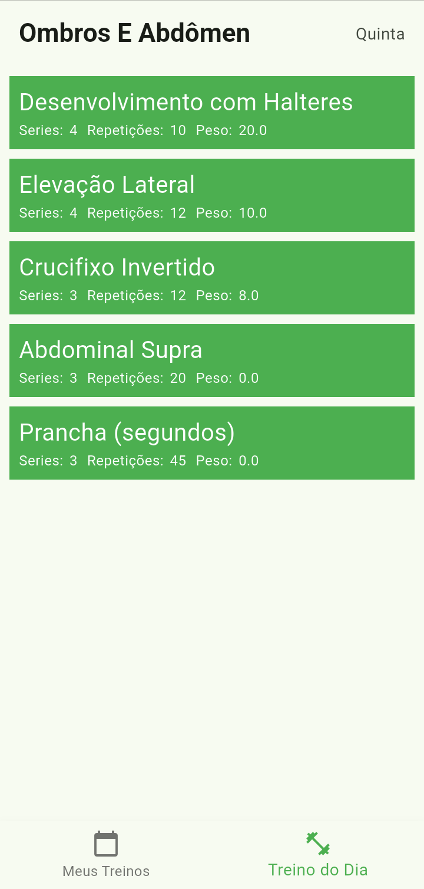
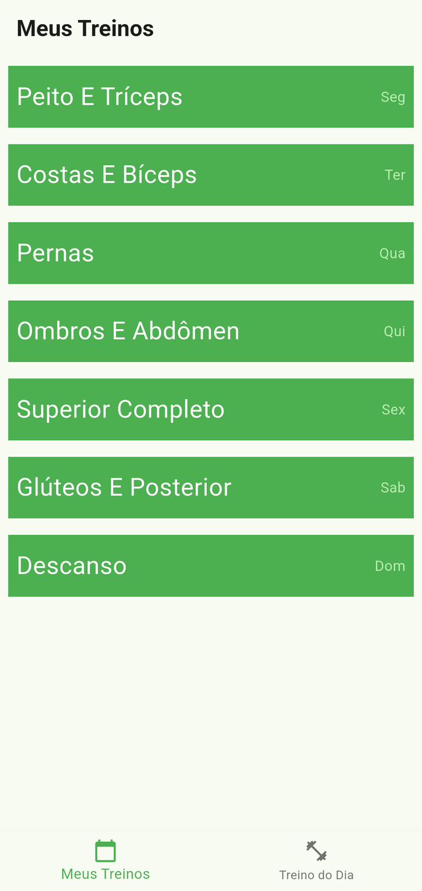
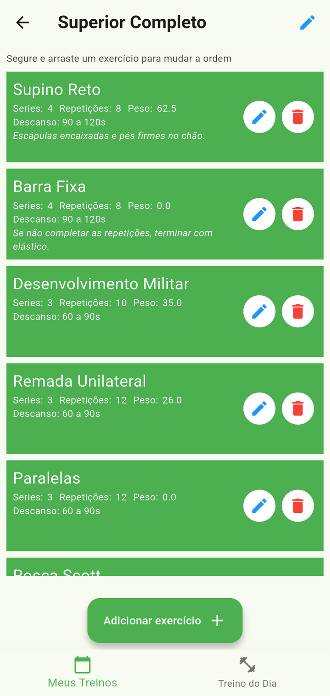
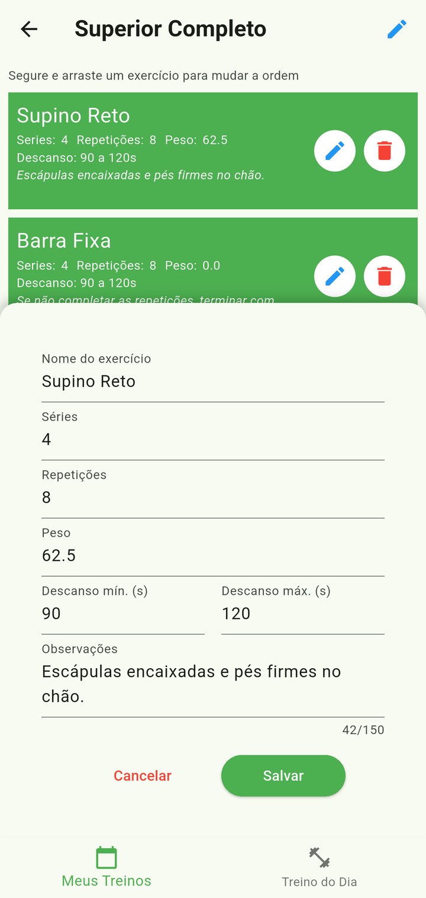
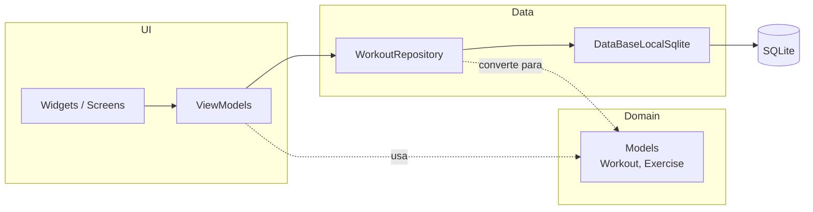

# Meus Treinos

App mobile em Flutter para organizar a rotina de musculação da semana. Cada dia tem um treino, cada treino tem seus exercícios (séries, repetições e carga), e a tela inicial já mostra o treino do dia. Tudo funciona offline, com os dados salvos localmente em SQLite.

<p align="center">
  
  
  
  
</p>

## Funcionalidades

- **Treino do dia:** ao abrir o app, mostra o treino do dia da semana atual com a lista de exercícios.
- **Planejamento semanal:** um treino para cada dia, de segunda a domingo, criado automaticamente.
- **Gerenciamento de exercícios:** adicionar, editar e excluir exercícios, com confirmação antes de excluir.
- **Renomear treinos:** por exemplo, "Peito e Tríceps" ou "Pernas".
- **Validação de formulário:** aceita peso com vírgula ou ponto (`20,5` ou `20.5`).
- **100% offline:** persistência local com SQLite.

## Tecnologias

| Finalidade | Pacote |
| --- | --- |
| Framework | [Flutter](https://flutter.dev) (Dart 3.9) |
| Injeção de dependência | [provider](https://pub.dev/packages/provider) |
| Navegação | [go_router](https://pub.dev/packages/go_router) (`ShellRoute` com bottom navigation) |
| Tratamento de erros | [result_dart](https://pub.dev/packages/result_dart) |
| Estado de ações assíncronas | [result_command](https://pub.dev/packages/result_command) |
| Modelos imutáveis | [freezed](https://pub.dev/packages/freezed) |
| Banco de dados local | [sqflite](https://pub.dev/packages/sqflite) |

## Arquitetura

O projeto segue o [guia oficial de arquitetura do Flutter](https://docs.flutter.dev/app-architecture): MVVM com camadas de UI, domínio e dados.



- **Widgets:** só desenham a tela e repassam as ações do usuário para o ViewModel.
- **ViewModels:** expõem o estado da tela e as ações como `Command`s. Cada `Command` informa por si só se está executando, se terminou com sucesso ou se falhou, e isso controla os loadings da interface.
- **Repository:** é a fonte da verdade para a UI. Converte os modelos do banco nos modelos de domínio e devolve `Result<T>` em vez de lançar exceções.
- **Service (SQLite):** acessa o banco por trás da interface `DataBaseLocalInterface`, então a implementação pode ser trocada, por exemplo por uma versão fake nos testes.

### Decisões técnicas

- **Result pattern em vez de exceções:** os erros fazem parte do tipo de retorno (`Result<Workout>`), então quem chama é obrigado a tratar o caso de falha.
- **Exceções tipadas na camada de dados:** a `DataBaseLocalException` carrega uma mensagem para o usuário, uma mensagem técnica para log e um `code` (ex: `SQLITE_DELETE_EXERCISE_NOT_FOUND`).
- **Modelos de banco separados dos de domínio:** `WorkoutDbModel` e `Workout` evoluem de forma independente, e a UI não depende do formato das tabelas.
- **Integridade no banco:** chaves estrangeiras habilitadas (`PRAGMA foreign_keys`) e `ON DELETE CASCADE` entre treinos e exercícios.

### Estrutura de pastas

```
lib/
├── data/
│   ├── repositories/workouts/   # WorkoutRepository e sua interface
│   └── services/
│       ├── local/               # Implementação SQLite e interface
│       ├── models/              # Modelos do banco (freezed)
│       └── exceptions/          # Exceções tipadas
├── domain/models/               # Workout, Exercise (freezed)
├── ui/
│   ├── app/                     # MaterialApp, rotas e bottom navigation
│   ├── shared/                  # Bottom sheets e diálogos reutilizáveis
│   ├── workout_day/             # Tela "Treino do Dia"
│   ├── workouts_manager/        # Tela "Meus Treinos"
│   └── workout_details/         # Detalhes e edição de um treino
└── utils/                       # Extensões de String
```

Cada feature em `ui/` tem uma pasta `view_model/` e uma pasta `widgets/`.

## Como rodar

Pré-requisitos: [Flutter SDK](https://docs.flutter.dev/get-started/install) 3.35 ou superior (Dart 3.9) e um emulador ou dispositivo Android/iOS.

```bash
git clone https://github.com/cesargehres/meus_treinos.git
cd meus_treinos
flutter pub get
flutter run
```

Os arquivos gerados pelo freezed (`*.freezed.dart`) já estão versionados. Se você alterar algum modelo, gere esses arquivos de novo:

```bash
dart run build_runner build --delete-conflicting-outputs
```

## Autor

Feito por [César Gehres](https://github.com/cesargehres).
